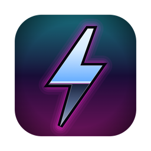

  

<h1 align="center">Ternt</h1>

  A browser and a terminal in one window, with an AI agent in every space. 
  Spaces in a sidebar instead of a strip of tabs, for macOS.

  <a href="https://github.com/jonkarrer/ternt/releases/latest"><b>Download for macOS</b></a>
  &nbsp;·&nbsp; <a href="docs/GUIDE.md">Guide</a>
  &nbsp;·&nbsp; <a href="docs/ARCHITECTURE.md">Architecture</a>
  &nbsp;·&nbsp; <a href="docs/CASE_STUDY.md">Case study</a>

---

## What it is

Ternt keeps the pages and the shells of one piece of work together. A space holds its own tabs,
its own sign-ins, its own terminals and its own agent; switching space switches all of them.

- **Spaces and a sidebar, not a tab strip.** Favorites shared across spaces, pinned tabs in
  folders, and a Today list you clear when the day is done.
- **Terminals are tabs.** A real shell sits beside the pages it belongs to, splits into panes,
  and can share the screen with web pages in a group of up to four.
- **One command bar.** ⌘T opens a URL, searches, switches tabs and spaces, finds history, runs
  commands, searches a site (`you` ⇥ for YouTube) or asks the agent (`tok` ⇥).
- **A profile per space.** Separate cookies and logins, so work Gmail and personal Gmail never
  meet.
- **An agent that remembers, per space.** Tokidoki learns from the conversations in its space
  and nothing crosses to another. Bring your own key; switch it off entirely if you prefer.
- **Little Ternt.** Links from other apps open in a small window you can read and close, or
  rules send them straight to the right space.
- **Light on memory.** Tabs load when first shown and let go of their page after 30 minutes
  off screen.
- **Updates itself.** New versions download in the background and install when you quit.

## Install

1. Download the `.dmg` from the [latest release](https://github.com/jonkarrer/ternt/releases/latest).
2. Open it and drag Ternt to Applications.
3. Launch it. A short setup asks whether to use the agent, and for your keys if so.

Needs macOS 14 or later, on Apple silicon or Intel. Releases are signed and notarized.

## The shortcuts worth knowing first

| Shortcut | Action |
|---|---|
| ⌘T | Command bar |
| ⌘L | Edit the current URL |
| ⌥⌘T | New terminal |
| ⌘D / ⇧⌘D | Split the terminal right / below |
| ⌘S | Show or hide the sidebar |
| ⌃1–⌃9 | Switch space (or swipe two fingers across the sidebar) |
| ⌃F | Explore tabs with the keyboard |
| ⌃A | Ask Tokidoki, this space's agent |
| ⌃H | Every shortcut and how-to, searchable |

The rest are in the [guide](docs/GUIDE.md#shortcuts).

## The agent

Press ⌃A, or type `tok` ⇥ and a question in the command bar. Tokidoki answers with a model from
Fireworks AI or Anthropic, chosen per space, using your own API key from the macOS Keychain. It
can search the web (through Exa) and it keeps what it learns about you, which you can read,
correct or wipe in Settings.

It runs in its own process, so a failure there never takes the browser down. More in the
[guide](docs/GUIDE.md#the-agent).

## Documentation

| | |
|---|---|
| [Guide](docs/GUIDE.md) | Everything the app does: sidebar, groups, terminals, profiles, links, downloads, settings, the agent |
| [Architecture](docs/ARCHITECTURE.md) | How it is built: webviews, state, terminals, sessions, the agent host |
| [Development](docs/DEVELOPMENT.md) | Setup, tests and releases |
| [Agent sidecar protocol](docs/AGENT-SIDECAR.md) | The contract between Ternt and the agent process |
| [Releasing](docs/RELEASING.md) | One-time setup of the signing Mac, and how a release is made |
| [Case study](docs/CASE_STUDY.md) | How Ternt was built: choices, obstacles and what they taught |
| [tokidoki](tokidoki/README.md) | The agent itself |

## Built with

[Tauri v2](https://tauri.app) and Rust, [Svelte 5](https://svelte.dev), WebKit and
[xterm.js](https://xtermjs.org).

## License

Ternt is source-available, not open source. You may read the code and run the published
releases; copying, modifying and redistributing it need permission. See [LICENSE](LICENSE).

The app shows the same terms under *Help → License*, and the notices of the open-source software
it includes under *Help → Third-Party Licenses*.

Ternt is provided as is, without warranty. The agent's answers come from third-party models and
can be wrong; what you ask it is sent to the providers whose keys you set, and billed by them to
you.

Copyright © 2026 Jon Karrer.
